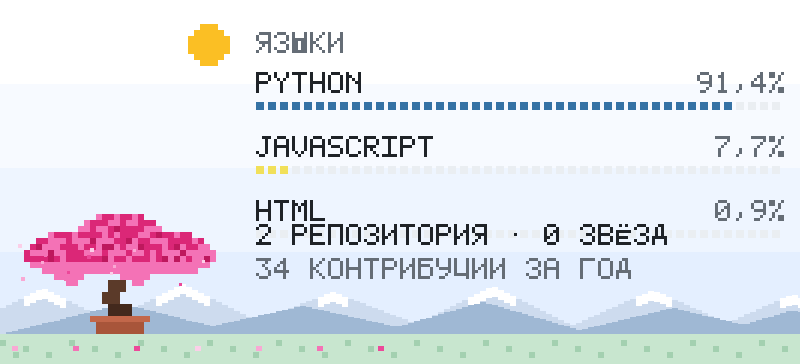

<h1>Oneyann</h1>

<!-- Контакты: раскомментируй и подставь свои ссылки

-->

## Статистика

## Граф вкладов

  <picture>
    <source media="(prefers-color-scheme: dark)" srcset="https://raw.githubusercontent.com/Oneyann/Oneyann/output-3d-contrib/night.svg" />
    <source media="(prefers-color-scheme: light)" srcset="https://raw.githubusercontent.com/Oneyann/Oneyann/output-3d-contrib/day.svg" />
    
  </picture>

---

  Пишу то, чем пользуюсь сам. Идеи и найденные баги — в issues репозиториев.

